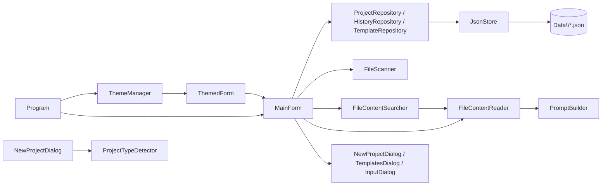
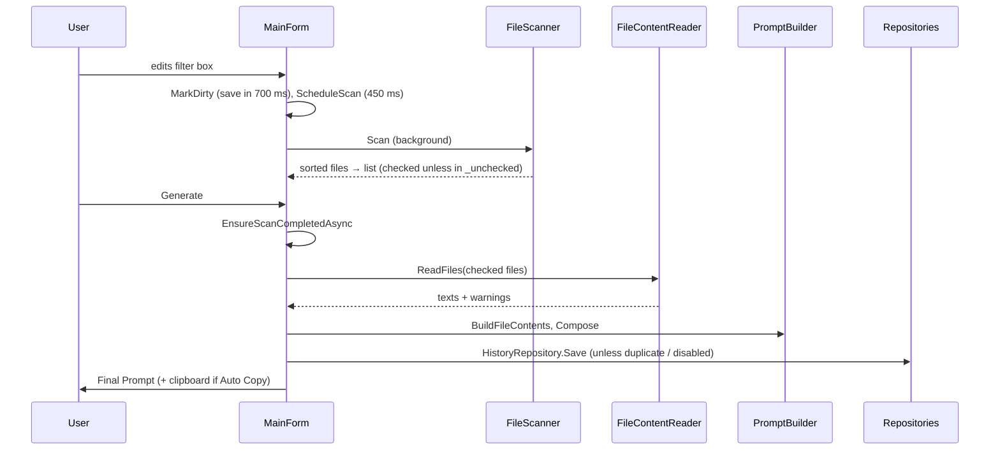

# Architecture — FilePromptAssembler

A single WinForms project (`net10.0-windows`, WinExe) with no external packages. It has three layers:

- **Models:** plain data classes that are serialized to JSON.
- **Services:** no UI code. Persistence, scanning, reading, searching, building the prompt, templates.
- **UI:** forms, dialogs, controls and theming. `MainForm` holds the application logic.



## Folders

| Folder | Purpose |
|---|---|
| `Models/` | The shape of the persisted data: settings, projects, state, history, templates |
| `Services/` | Logic that does not depend on WinForms controls, so it can run on background threads |
| `UI/` | `MainForm`, split into logic (`MainForm.cs`) and layout (`MainForm.Layout.cs`) |
| `UI/Controls/` | Reusable themed controls and factory helpers, so every window looks the same |
| `UI/Dialogs/` | Modal dialogs |
| `UI/Theming/` | Theme definitions, the theme manager, native dark-mode calls and the menu renderer |

## Startup and data locations

### `Program.cs` — `Program`

`Main()` is the entry point. It runs these steps in order:

1. Calls `ApplicationConfiguration.Initialize()`. This applies PerMonitorV2 DPI and the Segoe UI 9pt default font from the csproj.
2. Installs global exception handlers. They call `ShowFatal`, which shows a message box.
3. Creates `AppPaths(<exe folder>\Data)` and calls `EnsureCreated()`.
4. Takes the single-instance mutex `Local\FilePromptAssembler_<SHA256(data root)[..16]>`. A second instance shows a message and exits. Because the name comes from the data folder, Debug and Release builds can run at the same time.
5. Loads `settings.json` into `AppSettings`.
6. Calls `ThemeManager.Initialize(...)`.
7. Runs `Application.Run(new MainForm(...))`.

`AppName` is the window caption used everywhere.

### `Services/AppPaths.cs` — `AppPaths`

Stores the location of every data file in one place: `SettingsFile`, `ProjectsFile`, `TemplatesFile`, `ProjectStatesDirectory` (`Projects`), `HistoryDirectory` (`History`) and `ThemesDirectory` (`Themes`). `EnsureCreated()` creates these folders.

## Models

| Type | File | Purpose |
|---|---|---|
| `ProjectSortMode` | `AppSettings.cs` | Name / DateOpened / LastModified |
| `WindowPlacement` | `AppSettings.cs` | Window bounds and maximized flag, restored at startup |
| `AppSettings` | `AppSettings.cs` | App-wide settings (see below) |
| `ProjectInfo` | `ProjectModels.cs` | One entry of the project list: `Id`, `Name`, `FolderPath`, `AddedAt`, `LastOpenedAt`, `LastModifiedAt` |
| `ProjectState` | `ProjectModels.cs` | The full state of one project that is saved automatically |
| `HistoryEntry` | `ProjectModels.cs` | One generated prompt: its inputs, `SelectedFiles`, `UncheckedFiles` and `FileContents` |
| `TemplateKind` | `ProjectModels.cs` | Prompt / Exclude |
| `TextTemplate` | `ProjectModels.cs` | A name and its text |
| `TemplateLibrary` | `ProjectModels.cs` | The two template lists |

### `AppSettings`

| Group | Fields |
|---|---|
| General | `ThemeName` ("System"), `ProjectSort`, `ProjectSortDescending`, `SelectedProjectId`, `AutoCopy` (true), `BlankLinesAfterPrompt` (15; there is no UI for it) |
| Layout | `Window`, `MainSplitRatio`, `LeftSplitRatio`, `OutputSplitRatio` |
| New-project defaults | `LastNewProjectPromptTemplate`, `LastNewProjectExcludeTemplate`, `LastNewProjectFilePatterns` |
| Templates dialog | `LastPromptTemplateName`, `LastExcludeTemplateName`: the template to preselect when the dialog opens |

### `ProjectState`

- Inputs: `UserPrompt`, `PromptRightToLeft`, `IncludePatterns` ("*"), `ExcludePatterns`, `FilePatterns`.
- Outputs: `FinalPrompt`, `FileContents`.
- `DontAddToHistory`.
- `UncheckedFiles` stores only the files the user unchecked. Any other file found by a scan is checked, so newly added files start checked.

### `HistoryEntry` and `TemplateLibrary`

- `HistoryEntry.HasSameContentAs(other)` compares the prompt, the three filters, `FileContents` and `SelectedFiles` (order matters, case is ignored). It is used to skip a duplicate of the latest entry. `PromptRightToLeft` is not part of the comparison.
- `TemplateLibrary.Get(kind)` returns the list for a template kind.
- `TemplateLibrary.Find(kind, name)` looks up a template by name, case-insensitive, and returns null if it is not found.

## Services

### `JsonStore` (static)

This is the only place that reads and writes JSON.

- **Options:** indented output, relaxed escaping (Persian text stays readable), comments and trailing commas allowed, and two converters: `JsonStringEnumConverter` and `ColorJsonConverter`.
- **`Load<T>(path)`:** returns null if the file is missing or cannot be read. A file with invalid JSON is first copied to `*.damaged-yyyyMMdd-HHmmss` and then treated as missing, so the user never loses the original.
- **`Save<T>(path, value)`:** writes `path.tmp`, then calls `File.Move(..., overwrite: true)`. This makes the write atomic, so a crash cannot leave a half-written file.
- **`Delete(path)`:** deletes the file.
- **`event Error(string)`:** reports problems to the UI status bar instead of throwing. `MainForm.OnStoreError` subscribes to it.

### `Repositories.cs`

| Class | Members | Purpose |
|---|---|---|
| `ProjectRepository` | `LoadProjects`, `SaveProjects`, `LoadState(id)`, `SaveState(id, state)`, `DeleteState(id)` | Stores `projects.json` and `Projects\{id:N}.json` |
| `HistoryRepository` | `Load(id)` (newest first), `Save(id, entries)` (deletes the file when the list is empty), `Delete(id)` | Stores `History\{id:N}.json`, one file per project |
| `TemplateRepository` | `Library`, `Load()`, `Save()`, `Sorted(kind)` | Stores `templates.json`. On first run `Load` seeds the file from `DefaultTemplates`; it always normalizes newlines. `Sorted` orders templates by name with `CurrentCultureIgnoreCase` |

### `FileScanner.cs`

- **`WildcardSet`**
  - Parses filter lines: trims them, turns `\` into `/`, strips a leading `./` and surrounding `/`, and skips empty lines.
  - Special lines: `.` sets `ContainsRootMarker`; `*` and `**` set `MatchesEverything`.
  - A line without `/` goes to the name patterns. A line with `/` goes to the path patterns.
  - `Matches(name, relativePath)` uses `FileSystemName.MatchesSimpleExpression` and ignores case.
- **`ScanRequest(Root, Include, Exclude, FilePatterns)`** is the scan input. **`ScanResult`** returns `Files`, `Truncated`, `InaccessibleFolders` and `NoFilePatterns`.
- **`FileScanner.Scan(request, ct)`** walks the folders iteratively with a stack, so deep trees cannot cause a stack overflow:
  1. **Include:** a folder whose name or path matches includes all of its sub-folders. An empty Include, or `*`, means everything. `.` means the files of the project root.
  2. **Exclude:** a matching file is skipped. A matching folder is not entered at all.
  3. **Files Wildcard:** only matching files are kept. An empty wildcard list returns `NoFilePatterns` and no files.
  - Reparse points (junctions and symlinks) are skipped to avoid loops.
  - The scan stops at `MaxFiles = 20000` and sets `Truncated`.
  - The result is sorted with `RelativePathComparer`.
- **`RelativePathComparer`** compares the folder segments one by one (ordinal, case-insensitive). At the same level, files come before sub-folders, because fewer segments sort first. File names are compared last.

### `PromptBuilder.cs`

- **`FileContentReader`**
  - `ReadFiles(root, relPaths)` returns a `FileReadResult` with `Files` (`FileText(RelativePath, Content)`, newlines normalized) and `Warnings`. A file is skipped with a warning if it is missing, larger than `MaxFileSize` (10 MB), binary or unreadable.
  - `TryReadText(FileInfo)` applies the same rules but returns null instead of a warning. `FileContentSearcher` uses it.
  - A file counts as binary if it has a NUL byte in its first 8000 bytes and no UTF-16 BOM.
  - Encoding is detected from the BOM, with UTF-8 as the fallback.
- **`PromptBuilder`**
  - `BuildFileContents(files)` writes each file as the block below, with an empty line between blocks. All output uses `\r\n`.
    ```
    <FILE>
    <PATH>rel/path</PATH>
    <INDEX>i/n</INDEX>
    <CONTENT>
    ...
    </CONTENT>
    </FILE>
    ```
  - `Compose(userPrompt, fileContents, blankLines)` joins the prompt and the contents with at least one newline. If either part is empty, it returns only the other part.

### `FileContentSearcher.cs` — `FileContentSearcher`

Supports the content search in the Files list.

- `Search(root, relPaths, phrase, ct)` returns the set of relative paths whose text contains `phrase`. It uses `OrdinalIgnoreCase` and runs `Parallel.ForEach` with half of the CPU cores.
- File texts are cached by full path together with their `LastWriteUtc` and `Length`, so typing more letters does not read the files again.
- `Clear()` empties the cache. It is called when another project is loaded.

### `ProjectTypeDetector.cs`

`Detect(folder)` returns a `ProjectDetection(Description, PromptTemplate, ExcludeTemplate, FilePatterns)`, which `NewProjectDialog` uses to suggest defaults.

- **C#:** applies when `*.csproj` files are found (up to 3 levels deep, outside bin/obj) or the folder has a `.sln`/`.slnx`. The content of the csproj files decides the type, checked in this order:
  1. cTrader / cAlgo
  2. `<UseMaui>true`
  3. Sdk.Web or Sdk.Razor (ASP.NET Core)
  4. `<UseWPF>true`
  5. `<UseWindowsForms>true`
  6. `<OutputType>Exe` (console)
  7. Generic C#
- **Python:** `pyproject.toml`, `requirements.txt` or `*.py` files (up to 2 levels deep).
- **JS/TS:** `package.json`.
- Anything else returns `Unknown`.
- The template names it returns must match names in `DefaultTemplates`. If a name is missing, the dialog falls back to the last template used.

### `DefaultTemplates.cs`

`Create()` returns the library that is written to `templates.json` on first run.

- **Prompt templates:**
  - Each one is `GeneralRules` (the user's Persian rules, verbatim), then `## اطلاعات پروژه:` with project-type information, then an empty `## درخواست:` section.
  - The templates are: C# .NET MAUI, C# ASP.NET Core, C# Console Application, C# cTrader, C# Windows Application, C# WPF Application, JavaScript / TypeScript, Python.
- **Exclude templates:** C# (`obj`, `bin`, `.vs`), JavaScript / Node.js, Python.

### `TextUtil.cs`

| Member | Purpose |
|---|---|
| `TextUtil.NormalizeNewLines` | Converts all newlines to `\r\n`, which WinForms text boxes need |
| `TextUtil.Lines` | Returns the non-empty, trimmed lines (filter input) |
| `TextUtil.ContainsRtl` | Detects Hebrew or Arabic-script letters, used to switch on RTL automatically |
| `TextUtil.LastNonEmptyLine` | Returns the last non-empty line; the history list shows it as the request summary |
| `PathUtil.Normalize` | Makes the path absolute and removes trailing separators |
| `PathUtil.AreEqual` | Compares paths case-insensitively, used to detect duplicate projects |
| `PathUtil.DefaultProjectName` | Returns the innermost folder name |
| `ShellHelper.OpenFolder` | Opens a folder with `UseShellExecute`, so the user's default folder handler is used, not always Explorer |

## UI

### `UI/MainForm.Layout.cs` (layout only)

`BuildUi()` creates the following window:

```
MenuStrip (File | Prompt | Templates | View>Theme | Help)
_mainSplit (vertical)
 ├─ _leftSplit (horizontal): Projects section | History section
 └─ _workArea (TableLayoutPanel): Prompt | Filters row (Include | Exclude | Files Wildcard, 33.3% each)
                                  | Files section | Action bar | _outputSplit (Final Prompt | File Contents)
StatusStrip (_statusText, _statusPath)
```

| Builder | What it creates |
|---|---|
| `BuildMenu` | The menu bar |
| `RebuildThemeMenu` | The theme menu: System, built-in and custom themes, Open Themes Folder, Reload Themes |
| `BuildProjectsSection` | Add, Remove, sort combo, ▲/▼ direction button, `_projectList` and its context menu |
| `BuildHistorySection` | `_historyList`, Restore, Delete, "Clear ▾" with its menu, and a context menu |
| `BuildPromptSection` | `_promptBox`, the RTL toggle and Open Template… |
| `BuildFiltersRow` | `_includeBox`, `_excludeBox` with Templates…, `_wildcardBox` |
| `BuildFilesSection` | A top row with `_checkAll`, `_fileCount`, `_fileSearch` (260 px) and ✕, plus Refresh and `_fileList` (`CheckedListBox`) |
| `BuildActionBar` | Generate (primary), Copy, Auto Copy, Don't add to history |
| `BuildOutputs` | `_finalBox` and `_contentsBox`, each with a characters/tokens label |

Fields marked `null!` are assigned in these builders.

### `UI/MainForm.cs` (logic)

**State:**

| Field | Meaning |
|---|---|
| `_current` | The open project |
| `_projects` | The project list |
| `_history` | The current project's history, newest first |
| `_unchecked` | Unchecked relative paths (case-insensitive) |
| `_allFiles` | The latest scan result |
| `_searchMatches` | The files matching the search |
| `_undoByProject` | Detached `UndoHistory[]` for each project |

**Timers (debounce):**

| Timer | Interval | Calls |
|---|---|---|
| `_saveTimer` | 700 ms | `FlushState` |
| `_scanTimer` | 450 ms | `ScanNow` |
| `_searchTimer` | 400 ms | `StartSearchNow` |

**Re-entrancy flags:**
- `_loading`: controls are being filled from a saved state.
- `_populatingFiles`: the file list is being filled.
- `_suppressProjectSelection`: the project list is being rebuilt.
- `_generating`: a Generate is running.

Main methods:

| Area | Method | Purpose |
|---|---|---|
| Startup | `MainForm(paths, settings)` | Creates the repositories, loads templates and projects, creates timers, builds the UI |
| | `ApplyWindowPlacement` | Restores the saved bounds if they are visible on a screen; otherwise uses the left half of the current screen |
| | `OnShown` | Applies splitter ratios (needs the final size), selects the last project, shows theme load errors, focuses the prompt with the caret at the end |
| | `ApplySplitter`, `Ratio` | Convert between splitter distance and the saved ratio, respecting DPI-scaled minimum sizes |
| | `OnFormClosing` | Cancels the scan, flushes the state, saves window bounds and ratios |
| Events | `WireEvents` | Connects all handlers: lists, buttons, text changes (mark dirty, rescan), RTL, search keys (Enter, Esc) |
| | `ProcessCmdKey` | Ctrl+Enter runs Generate |
| | `OnStoreError`, `SetStatus` | Show `JsonStore` errors and messages in the status bar (thread-safe) |
| Projects | `FormatProject` | Two-line item. The second line is the folder or a date, depending on the sort; a missing folder is dimmed |
| | `OnSortModeChanged`, `UpdateSortDirectionButton`, `SortedProjects`, `RefreshProjectList` | Sorting. Name sorts ascending by default; the date sorts descending. Ties are broken by path. The current selection is kept |
| | `AddProjectInteractive(folder?)` | Folder dialog or dropped folder → duplicate check → `ProjectTypeDetector` → `NewProjectDialog` → saves the initial state and selects the project |
| | `RenameProject` | An empty name resets to the folder name |
| | `RemoveProject` | Asks for confirmation, then deletes the state, history and undo data. The folder on disk is not touched |
| | `OpenProjectFolder(parent)`, `OpenFolderSafe` | Open a folder with error handling |
| | `OnDragEnter`, `OnDragDrop` | Drop a folder (or a file, which means its folder) to add a project. Uses `BeginInvoke` so the drag operation finishes first |
| Project state | `SwitchToProject` | Flushes and detaches the undo history of the old project, loads the new state and history, re-attaches its undo history, updates `LastOpenedAt` and starts a scan |
| | `LoadStateIntoControls` | Fills all boxes with `SetTextWithoutUndo`, resets the file list, search and search cache |
| | `CaptureState` | Turns the controls into a `ProjectState` |
| | `MarkDirty` | Sets `LastModifiedAt` and restarts the save timer |
| | `FlushState` | Saves the state and the project list if something changed |
| | `ShowNoProject` | Clears and disables the work area when no project is selected |
| | `UpdateTitle`, `SaveSettings` | `SaveSettings` also stores the selected theme name |
| Scan | `ScheduleScan`, `ScanNow`, `ScanAndPopulateAsync` | Debounced background scan. Results for a project that is no longer current are dropped; truncation and inaccessible folders are reported |
| | `EnsureScanCompletedAsync` | Generate waits for any pending or running scan, so it uses the current filters |
| | `PopulateFiles`, `RebuildFileList` | Store `_allFiles` and show all files, or only the search matches. Check states come from `_unchecked` |
| Search | `IsSearchActive`, `OnFileSearchChanged`, `StartSearchNow`, `RunSearchAsync`, `ClearFileSearch` | Debounced, cancellable content search. Results are dropped if the project or the phrase changed in the meantime |
| Checks | `OnFileItemCheck` | Keeps `_unchecked` in sync with the list. The count is updated through `BeginInvoke`, because `CheckedIndices` changes only after the event |
| | `ToggleAllFiles` | Select all / none for the files that are *shown* |
| | `UpdateFileCount` | Three-state Select all, plus the counter text |
| Generate | `GenerateAsync` | Waits for the scan → reads *all* checked files from `_allFiles`, including files hidden by the search (background) → builds the contents and final prompt → assigns them through `Text`, so Ctrl+Z works → history → auto copy → shows a warning box for skipped files |
| | `CopyToClipboard` | `Clipboard.SetDataObject` with 10 retries; reports when the clipboard is busy |
| | `UpdateOutputInfo` | Characters and ~tokens (length / 4) |
| History | `AddToHistory` | Respects Don't add to history, skips a duplicate of the latest entry, inserts at index 0 and saves |
| | `FormatHistory`, `RefreshHistoryList`, `UpdateHistoryButtons` | List display |
| | `RestoreSelectedHistory` | Puts the entry back into the boxes through `Text` (undoable) and rebuilds the final prompt with `Compose` |
| | `CopySelectedHistory`, `DeleteSelectedHistory`, `ClearHistory(keepLatest)` | Copy and delete entries |
| Other | `OpenTemplates(kind)` | Opens `TemplatesDialog`, remembers the last template, applies the chosen text (undoable). A prompt template also sets RTL automatically |
| | `ApplyTheme`, `SelectTheme`, `ReloadThemes`, `ShowAbout` | Themes and the About box |

### `UI/Dialogs/`

| Class | Purpose and main members |
|---|---|
| `InputDialog` | A single-line text prompt. `static Ask(owner, title, prompt, initial)` returns the text, or null when cancelled. Used for renaming projects and templates |
| `NewProjectDialog` | Shown when a project is added. Fields: Folder, Name (default folder name), Detected type, Prompt template, Exclude template (`(Empty)` or a template; preselected from the detected type, else the last choice), File wildcards. `CreateInitialState()` builds the first `ProjectState` (Include `*`, RTL from the template text) |
| `TemplatesDialog` | Shows the templates of one kind, sorted by name. The text is read-only until *Edit* is clicked. *Save* (or Ctrl+S) / *Cancel*. Changing the selection or closing while editing asks Save / Discard / Cancel. Also New…, Rename… (unique names), Delete, an RTL view toggle, *Use Template*. Outputs: `ChosenText`, `LastSelectedName` |

### `UI/Controls/`

| Type | Purpose |
|---|---|
| `UndoTextBox` + `UndoHistory`, `TextEdit` | A `TextBox` with its own diff-based undo and redo (max 500 steps or 16 M characters). `OnTextChanged` stores the common-prefix/suffix diff, so changes made by the program are undoable too. Typing within 1.5 s merges into one step until a new word starts; Backspace and Delete merge as well. Arrow keys and mouse clicks seal the current step. Keys: Ctrl+Z, Ctrl+Y / Ctrl+Shift+Z, Ctrl+A, Ctrl+Backspace (delete word). Own context menu. API: `SetTextWithoutUndo`, `ResetUndoHistory`, `DetachHistory` / `AttachHistory` (re-attaches only if the text is unchanged), `UndoEdit`, `RedoEdit`, `HasUndo`, `HasRedo` |
| `UiFonts` | `SectionTitle`, `Prose`, and `Code` (Cascadia Mono, falling back to Consolas) |
| `SectionPanel` | A bordered card with a title, tool buttons on the right (`AddTool`) and a `Body` panel |
| `BorderedHost` | Draws a 1 px themed border around a borderless control; the border uses the accent color while focused |
| `TwoLineListBox` + `ListItemText` | Owner-drawn list with a bold first line and a subtle second line. Uses `Formatter` and shows `EmptyText` when the list is empty. Used for projects and history |
| `Ui` (static) | Factories: `Button`, `ToolButton`, `Toggle`, `Label`, `Table`, `ButtonRow`, `CodeBox`; message helpers `Error`, `Info`, `Confirm` (default button is No) |

### `UI/Theming/`

| Type | Purpose |
|---|---|
| `Theme` | A color set: Background, Surface, Input, Border, Text, SubtleText, Accent, AccentHover, AccentText, Button, ButtonHover, Selection, SelectionText, plus `IsDark` |
| `BuiltInThemes` | `Light` and `Dark` |
| `ColorJsonConverter` | Writes colors as `#RRGGBB` or `#AARRGGBB` |
| `ThemeManager` (singleton, `Instance`) | Owns the theme list (built-in + `Data\Themes\*.json`, with duplicate or invalid files reported in `LoadErrors`) and writes `Themes\README.txt` once. Resolves "System" from the registry key `AppsUseLightTheme` and follows changes through `SystemEvents.UserPreferenceChanged`. API: `Select`, `Refresh`, `ReloadThemes`, `ThemeChanged` (may be raised on another thread). `Apply(control)` colors the control tree by type; `IThemeable` controls paint themselves. Constants: `PrimaryTag`, `SubtleTag`, `SystemThemeName` |
| `IThemeable` | Implemented by controls that apply a theme themselves |
| `ThemedForm` | The base class of every window. Sets DPI auto-scaling, applies the theme when the handle is created and when the theme changes (through `BeginInvoke` if needed), and unsubscribes on Dispose |
| `ThemedToolStripRenderer`, `ThemedColorTable` | Draw menus in theme colors, with an accent check mark |
| `NativeMethods` | `SetDarkTitleBar` (DWM attribute 20). `SetControlTheme` applies `DarkMode_Explorer` / `DarkMode_CFD` to scroll bars and combo boxes and re-applies them when the handle is recreated, for example after an RTL change |

## Data flow



Saving: a change to any input calls `MarkDirty`. After 700 ms `FlushState` writes `Projects\{id}.json` and `projects.json` (which carries LastModified). `FlushState` also runs when switching projects, adding a project and closing the window. Settings are saved as soon as they change.
